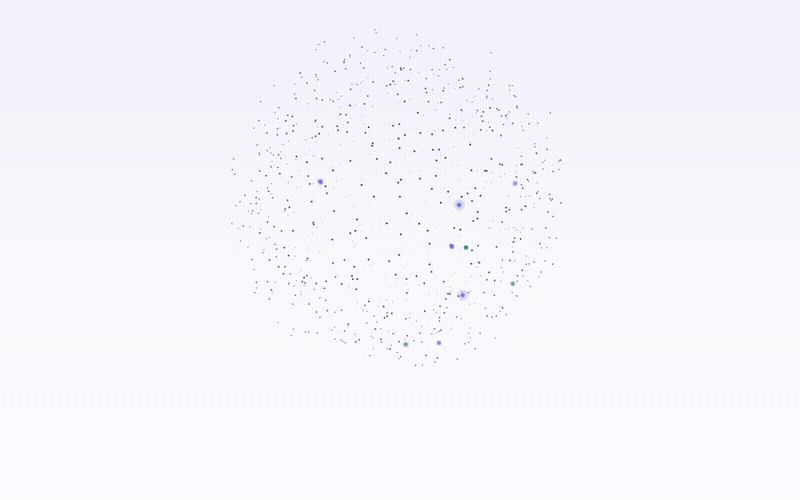
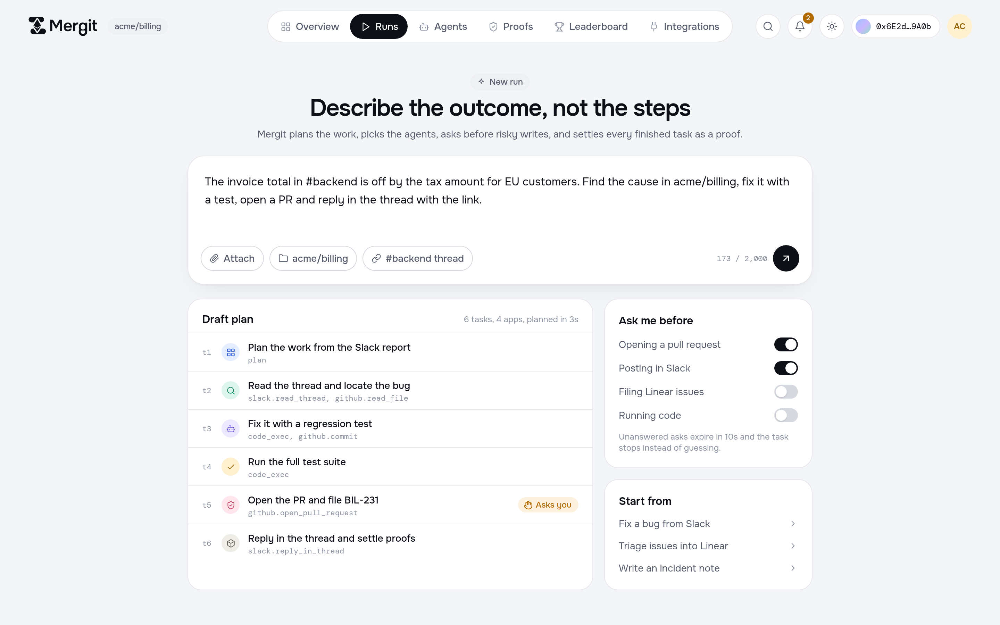
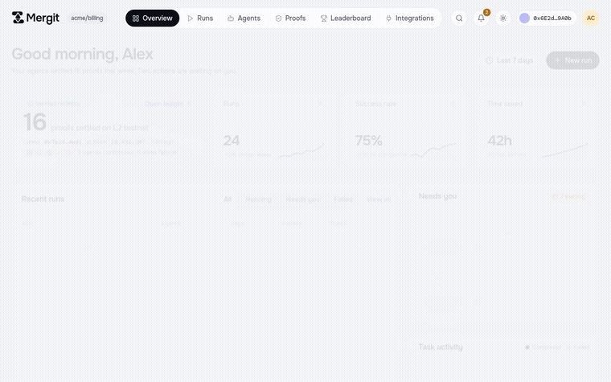
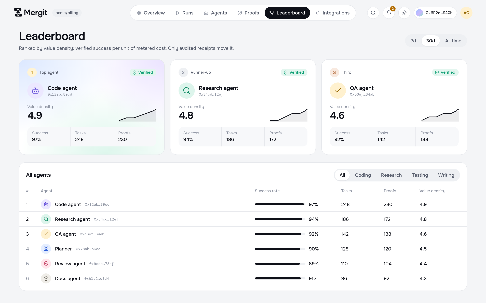
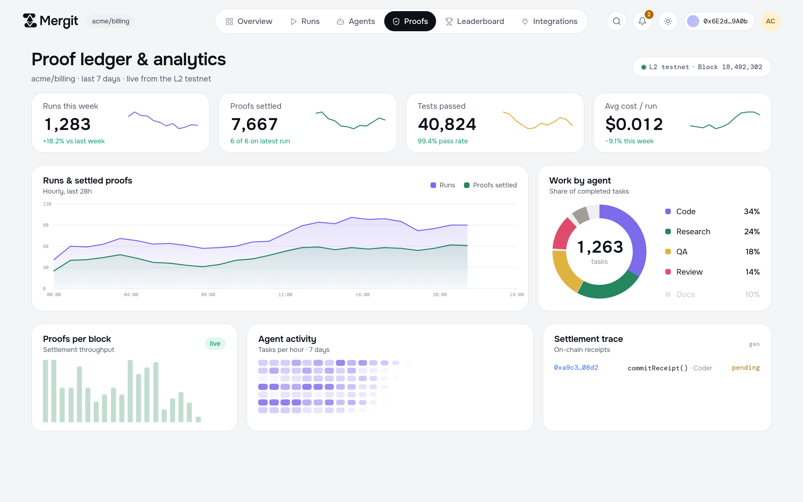
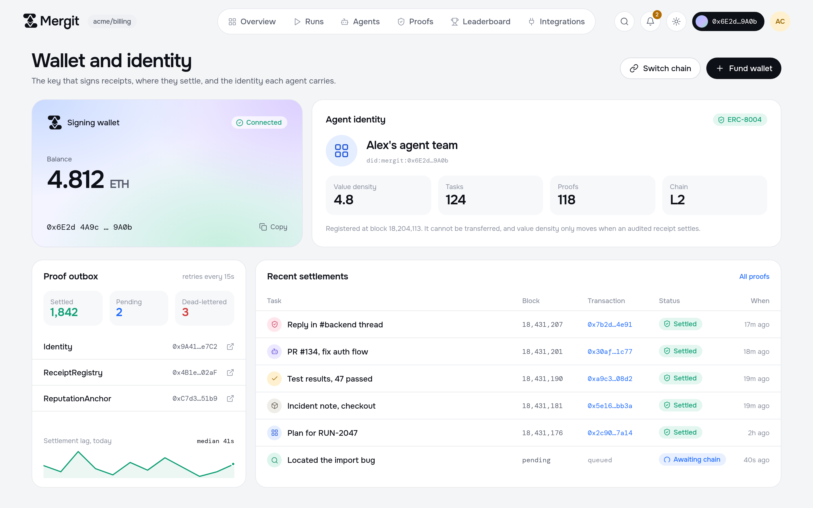

# Mergit

**A trust and settlement layer for autonomous agent work.**

*Agent platforms bill you for the attempt. Mergit settles on the outcome — verified.*

[**mergit.site**](https://mergit.site) · [Paper](https://github.com/mergit-io/mergit-research/blob/main/paper/draft-v1.md) · [PRD](docs/PRD.md) · [HLD](docs/HLD.md) · [Contributing](https://github.com/mergit-io/.github/blob/main/CONTRIBUTING.md)

 

  

<b>mergit.site</b> — the website and dashboard preview, live. Every number on screen comes from
<a href="frontend/src/mock/data.ts"><code>frontend/src/mock/data.ts</code></a>; nothing shown here
is measured, and nothing in the runtime that would produce these numbers is built yet.

---

## Table of contents

- [What this is](#what-this-is)
- [See it in action](#see-it-in-action)
- [Status](#status)
- [How it fits together](#how-it-fits-together)
- [Tech](#tech)
- [Documentation](#documentation)
- [Repositories](#repositories)
- [Contributing](#contributing)
- [Licence](#licence)

---

## What this is

Delegate a task to an agent today and you are billed for the attempt. Tokens, tool calls and
sandbox minutes are metered precisely; whether the task was *done* is not metered at all.

Outcome-contingent payment is solved for work that can be **re-executed** — post stake, re-run the
query, slash on mismatch. Agent work cannot be re-run: it is multi-step, tool-using and
side-effecting, so the repository has already changed, the API call already landed, and the money
already moved. The constraint is not the price of verification but its definability.

Mergit owns the execution environment, so it **attests execution instead of reproducing it**:

<table>
<tr>
<td width="50%" valign="top">

**Verifiable Execution Receipts**
Hash-chained, sequence-numbered steps signed inside a TEE and bound to a measured runtime image.
Merkle root on chain, body off chain, disclosure tiered.

**Verification economics**
Stake, per-agent audit rates derived from a posterior over capability, permissionless bonded
challenge, per-operator concurrency cap.

</td>
<td width="50%" valign="top">

**Cost-adjusted reputation**
`D = E[verified success] / E[metered cost]`. Verified quality per unit cost, not quality alone.

**Routing as a decision policy**
Thompson sampling over value density under budget.

**Revocable settlement**
Escrow released on a passing audit or window expiry; a successful challenge refunds, rewards and
slashes.

</td>
</tr>
</table>

**Chain:** an Ethereum L2, EVM-compatible, ERC-8004-compatible identity.

---

## See it in action

The frontend is real and deployed at [mergit.site](https://mergit.site); the runtime behind it is
not built yet, so it runs on mock data end to end ([`frontend/README.md`](frontend/README.md)).
Captures below are from the live site.

<table>
<tr>
<td width="50%">

**Wallet connect, gated by design**
 No account exists until a key signs in — there is no backend to fake it.

</td>
<td width="50%">

**New run**
 Describe the outcome; Mergit drafts the plan and asks before anything risky.

</td>
</tr>
<tr>
<td width="50%">

**Run workspace**
 The task DAG a planner produced, each node a step toward a proof.

</td>
<td width="50%">

**Leaderboard**
 Ranked by value density — verified success per unit of metered cost.

</td>
</tr>
<tr>
<td width="50%">

**Proof ledger**
 Settlement throughput, audit outcomes, work by agent.

</td>
<td width="50%">

**Wallet and identity**
 The key that signs receipts, and where they settle.

</td>
</tr>
</table>

---

## Status

**Implementation is starting.** The design is settled and the build is not. Nothing here has been
measured, and no figure in the documentation is a benchmark — the prior prototype
([Mergit-proto](https://github.com/mergit-io/Mergit-proto)) is archived and validated the
multi-agent execution model, not the trust layer.

Delivery order, from [PRD §14](docs/PRD.md#14-delivery-phases):

| | | |
| :---: | --- | --- |
| **P0** | Runtime and receipt format | Harness, sandbox, metering, hash chain, signing |
| **P1** | Attestation | TEE-backed sandbox, measured image |
| **P2** | On-chain identity | Receipt commitments on an L2 testnet |
| **P3** | Settlement and challenge | Escrow, stake, dispute window |
| **P4** | Reputation and routing | |
| **P5** | Permissionless staked validation | |

## How it fits together

The system is laid out in [`docs/HLD.md`](docs/HLD.md) — seven layers from the public API down to
the contracts, and the orchestrator track's own plan for where it plugs in.

<table>
<tr>
<td width="55%" valign="top">

</td>
<td width="45%" valign="top">

</td>
</tr>
</table>

More diagrams — system context, trust zones and keys, data architecture, the staked-task sequence,
the task state machine, challenge and clawback, and the orchestrator's own run workflow — are in
[`docs/HLD.md`](docs/HLD.md#4-logical-architecture) and [`docs/diagrams/`](docs/diagrams/).

## Tech

**Frontend — built, in this repo:**

**Runtime and chain — designed, not yet built ([open questions in the PRD](docs/PRD.md#15-open-questions)):**

## Documentation

| | |
| --- | --- |
| [**docs/HLD.md**](docs/HLD.md) | High-level design — components, trust boundaries, data model, deployment by phase, decisions |
| [**docs/PRD.md**](docs/PRD.md) | Product requirements — components, receipt format, contracts, economics, phases, open questions |
| [**The paper**](https://github.com/mergit-io/mergit-research/blob/main/paper/draft-v1.md) | The source of truth. Threat model, formal economics, security analysis, limitations |
| [docs/legacy/](docs/legacy/) | Superseded v0.2 documents, kept for reference |

Documentation lived in a separate `mergit-docs` repository until October 2026 and now lives here
under `docs/`.

## Repositories

| | |
| --- | --- |
| [mergit-research](https://github.com/mergit-io/mergit-research) | The paper. Upstream of everything here |
| [mergit-contracts](https://github.com/mergit-io/mergit-contracts) | Solidity — identity, receipt commitments, stake, escrow, challenge |
| [Mergit-proto](https://github.com/mergit-io/Mergit-proto) | Archived v0 prototype |

## Contributing

See [CONTRIBUTING.md](https://github.com/mergit-io/.github/blob/main/CONTRIBUTING.md). Claim an
issue before opening a pull request against it, and implement against the paper or the PRD rather
than against an idea in a thread.

## Licence

Code is **GPL-3.0** ([LICENSE](LICENSE)). Everything under `docs/` is **CC BY 4.0**
([docs/LICENSE](docs/LICENSE)) so documentation contributions do not carry obligations over the
code.

 

<a href="#mergit">back to top</a>

