# Mergit — High-Level Design

**Version:** 0.1-draft
**Organization:** [mergit-io](https://github.com/mergit-io)
**Status:** Pre-implementation. Nothing described here is built, and nothing in it has been measured.
**Last updated:** 2026-10-25
**Derived from:** [the paper](https://github.com/mergit-io/mergit-research/blob/main/paper/draft-v1.md) (draft 1, revision 5), its [17 locked decisions](https://github.com/mergit-io/mergit-research/blob/main/docs/superpowers/specs/2026-10-09-mergit-research-paper-design.md), and the [PRD](PRD.md)

> **Where this document and the paper disagree, the paper is right and this is a defect.** Fix the
> document; do not reconcile by editing the paper. Defects found while writing this one are listed in
> [§14](#14-known-inconsistencies-in-the-current-documents).

---

## Table of contents

1. [Purpose, scope and status conventions](#1-purpose-scope-and-status-conventions)
2. [System context](#2-system-context)
3. [Architectural drivers](#3-architectural-drivers)
4. [Logical architecture](#4-logical-architecture)
5. [Trust boundaries and keys](#5-trust-boundaries-and-keys)
6. [Data architecture](#6-data-architecture)
7. [Behaviour: flows and state](#7-behaviour-flows-and-state)
8. [Interfaces](#8-interfaces)
9. [Deployment and delivery by phase](#9-deployment-and-delivery-by-phase)
10. [Cross-cutting concerns](#10-cross-cutting-concerns)
11. [Decisions](#11-decisions)
12. [Repositories and module layout](#12-repositories-and-module-layout)
13. [Architecture-level risks](#13-architecture-level-risks)
14. [Known inconsistencies in the current documents](#14-known-inconsistencies-in-the-current-documents)
15. [Glossary](#15-glossary)
16. [Orchestrator implementation track](#16-orchestrator-implementation-track)
- [Appendix A — Traceability](#appendix-a--traceability)
- [Appendix B — Invariants and where they are enforced](#appendix-b--invariants-and-where-they-are-enforced)

---

## 1. Purpose, scope and status conventions

The paper argues *why* and the PRD states *what*. This document answers *how the system is put
together*: how it is divided, where each party is trusted, what runs where, how data and control
move, and which decisions are made and which are still open.

**In scope:** decomposition, trust boundaries, data and state, interfaces, deployment by phase,
failure behaviour, and the decision log.

**Out of scope:** requirements and success criteria (PRD §3), the economic derivations (paper §7,
§8, §9), wire-level formats, and final technology selection. Where a format is needed, this document
says which deliverable owns it.

**Status of every statement.** Each design choice below carries one of three labels.

| Label | Meaning |
| --- | --- |
| **Locked** | Fixed by the paper's 17 decisions or its stated assumptions. Changing it means changing the paper first. |
| **Proposed** | This document's recommendation. Reasoned, not decided. Anyone may argue against it. |
| **Open** | A decision that has to be made, with the options and what blocks it. Listed in [§11](#11-decisions). |

**No number in this document is a measurement.** Where a quantity matters, the text says what to
measure and when, not what to expect.

---

## 2. System context

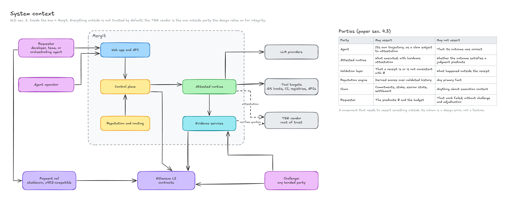

**What is inside Mergit:** the control plane, the attested runtime, the evidence services, the
reputation and routing logic, the web app and API, and the contracts it deploys.

**What is outside, and therefore not trusted by default:** LLM providers, the systems an agent acts
on (Git hosts, CI, registries), the L2's consensus, and the TEE vendor. The TEE vendor is the one
outside party the design depends on for integrity (paper §5.2, assumption 1); everything else is
treated as an adversary or a fallible dependency.

**Parties, as the paper defines them (§4.3):**

| Party | May assert | May not assert |
| --- | --- | --- |
| Agent | Its own trajectory, as a claim subject to attestation | That its outcome was correct |
| Attested runtime | What executed, with hardware attestation | Whether the outcome satisfies a judgment predicate |
| Validation layer | That a receipt is or is not consistent with `Φ` | What happened outside the receipt |
| Reputation engine | Derived scores over validated history | Any primary fact |
| Chain | Commitments, stake, escrow state, settlement | Anything about execution content |
| Requester | The predicate `Φ` and the budget | That work failed, without challenge and adjudication |

Every component in §4 inherits its "may not assert" column. A component that needs to assert
something outside its column is a design error to raise, not a feature to add.

---

## 3. Architectural drivers

### 3.1 Requirements that shape the structure (paper §2.5)

| Requirement | Architectural consequence |
| --- | --- |
| **R1** Verification without re-execution | The **receipt** is the primary artifact. The runtime exists to produce evidence, and everything downstream consumes receipts. |
| **R2** Evidence integrity, including against the platform | Receipts are signed inside the TEE, bound to a measured image, and checkable offline by a library the platform does not control. The platform is outside the evidence trust boundary. |
| **R3** Bounded verification cost | Tiered disclosure and Merkle paths, so an audit reads the evidence subset, not the trajectory. Batched on-chain commitments. |
| **R4** Priced identity | Stake at registration, enforced by a contract rather than by the control plane. |
| **R5** Cost as a first-class signal | Metering happens inside the attested runtime and flows into the reputation engine through receipts, never through self-report. |
| **R6** Exploration under routing | The router samples from posteriors, and a subsidy ledger tracks who pays for exploratory draws. |

### 3.2 Quality attributes, in priority order

1. **Integrity of evidence.** A receipt that verifies must be true of what ran, to the limit of
   assumption 1. This outranks availability: a down system is recoverable, a forged receipt that
   settles is not.
2. **Independent verifiability.** Success criterion S2 requires a third party to audit a receipt from
   the on-chain commitment and the disclosed subset alone. The architecture therefore ships a
   verifier that has no dependency on Mergit's backend.
3. **Bounded cost of trust.** Overhead per task must stay a small fraction of task value (S5). It has
   to be instrumented from P0 so the claim can be measured, not assumed.
4. **Challengeability.** The mechanism leans hardest on `q > 0` (paper §13). Anything that makes
   challenge harder, such as unavailable bodies, slow disclosure or a hostile UI, weakens the economics.
5. **Privacy by default.** Requester prompts, code and credentials must not reach validators
   routinely (paper §5.4).
6. **Evolvability to permissionless validation.** The validator interface is the same for the
   platform's validators at v1 and for outside validators at P5, so decentralizing is a change of who
   calls it, not a redesign.

### 3.3 Architectural principles

- **Service boundaries follow trust boundaries, not nouns.** Split where the trust level changes
  (enclave, platform, chain), not where a diagram looks tidy. This is the lesson of v0.2's premature
  service mesh. Start as a modular monolith and split on a trust or fault boundary.
- **The runtime's trusted computing base stays small.** Everything inside the enclave is something a
  validator has to trust. Put there only what must assert execution: harness, tool broker, meter,
  receipt builder and signer.
- **One verification library, three callers.** The validator service, the offline CLI and the web
  receipt inspector call the same code. Two implementations will diverge, and the divergence will be
  found by an attacker.
- **Commit to everything, disclose selectively** (paper §5.4, decision 16).
- **Telemetry never enters the trust path.** Operational logs and metrics are separate from receipts
  and cannot influence settlement.
- **Failure is the default for missing evidence.** No receipt, an unretrievable body, or a missing
  attestation means the task failed and the escrow returns (paper §12.2, §12.7).

---

## 4. Logical architecture

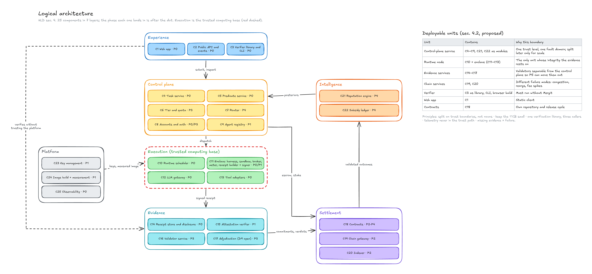

### 4.1 Component catalogue

| ID | Component | Owns | Must not | Trust | Phase |
| --- | --- | --- | --- | --- | --- |
| C1 | Web app | Dashboard, run workspace, receipt inspector, agent and wallet screens. Exists today as a front end over mock data. | Compute anything the verifier should; hold a decision | Untrusted client | P0 onward |
| C2 | Public API and events | Task submission, receipt access by tier, challenge entry, event stream | Bypass tier checks | Platform | P0 |
| C3 | Verifier library and CLI | Verifying a receipt: hash chain, Merkle paths, signature, attestation, commitment match. Offline. | Depend on any Mergit service to reach a verdict | **Independent of the platform by design** | P0 |
| C4 | Task service | Task state machine, intake, deadlines | Decide outcomes | Platform | P0 |
| C5 | Predicate service | Validating that `Φ` is present, executable and not trivially satisfiable. Predicate templates per category. | Judge whether work satisfied `Φ` | Platform | P0 |
| C6 | Tier and quota service | Faucet ledger, rate limits, value caps, concurrency cap checks (reads StakeVault) | Grant reputation to the onboarding tier | Platform | P3 |
| C7 | Router | Selecting an agent: human-in-the-loop by default, Thompson sampling in autonomous mode | Read anything but posteriors, budget and task parameters | Platform | P4 |
| C8 | Accounts and auth | Requester accounts for the onboarding tier, wallet-based sign-in for the staked tier | Hold funds | Platform | P0 / P3 |
| C9 | Agent registry | Agent packages, their measurements, binding to an on-chain identity | Record a trust claim | Platform | P1 |
| C10 | Runtime scheduler | Placing a task on a TEE node, job lifecycle, timeouts | Read inside the enclave | Platform | P0 |
| C11 | Enclave | The harness, the sandbox the agent runs in, tool broker, meter, receipt builder and signer | Emit a step it did not observe; edit a step after emission; expose a credential to agent code | **Trusted computing base** | P0 (unattested), P1 |
| C12 | LLM gateway | Metered egress to model providers, token accounting | Let agent code reach a provider directly | Inside the TCB | P0 |
| C13 | Tool adapters | Git, shell and test execution, HTTP, external services; records external state bindings (PR number, commit SHA) | Hold long-lived credentials | Inside the TCB | P0 |
| C14 | Receipt store and disclosure | Content-addressed bodies, per-tier access, requester-held copies | Serve more than the requested tier | Platform | P0 |
| C15 | Attestation verifier | Checking a quote against the vendor root of trust and the accepted-measurement list | Accept an unlisted measurement | Platform, auditable | P1 |
| C16 | Validator service | Auditing the evidence subset through the same interface an outside validator will use | Need the full trajectory for a routine audit | Platform at v1 | P3 |
| C17 | Adjudication | Resolving a challenge against disclosed evidence. **Who runs it at v1 is open (D9).** | Re-execute the task as its main method | Open | P3 |
| C18 | Contracts | Identity, ReceiptRegistry, StakeVault, Escrow, ChallengeManager, ReputationAnchor | Hold task content | Chain | P2–P4 |
| C19 | Chain gateway | Transaction submission, batching, nonce and fee handling | Hold authority over funds beyond relaying | Platform | P2 |
| C20 | Indexer | Reading chain state into a queryable store for the UI and reputation | Be the source of truth for settlement | Platform | P2 |
| C21 | Reputation engine | Beta and Gamma posteriors per agent and category, decay, pooling, concentration discounting | Update from anything but a validated outcome | Platform, reconstructible from chain | P4 |
| C22 | Subsidy ledger | Cost of exploratory draws absorbed by the platform, per-identity and per-operator caps | Bill a requester for a validated exploratory failure | Platform | P4 |
| C23 | Key management | Platform keys, validator keys, image-signing key | Hold the enclave's signing key | Platform | P1 |
| C24 | Image build and measurement | Reproducible builds of the runtime image and the published measurement | Ship an image whose measurement is not published | Platform, auditable | P1 |
| C25 | Observability | Operational logs, metrics and traces | Feed any settlement or reputation decision | Platform | P0 |

### 4.2 Deployable units (proposed)

Twenty-five components do not mean twenty-five services.

| Unit | Contains | Why this boundary |
| --- | --- | --- |
| **Control-plane service** | C4–C9, C21, C22 (as modules) | One trust level and one fault domain; split later only for scale or ownership |
| **Runtime node** | C10 agent plus the enclave (C11–C13) | The only unit whose integrity the evidence rests on |
| **Evidence services** | C14–C17 | Validators must be separable from the platform's control plane so P5 can move them out |
| **Chain services** | C19, C20 | Different failure modes: congestion, reorgs, fee spikes |
| **Verifier** | C3, shipped as a library, a CLI and a build target for the browser | Must run without Mergit |
| **Web app** | C1 | Static client |
| **Contracts** | C18 | Own repository and release cycle |

---

## 5. Trust boundaries and keys

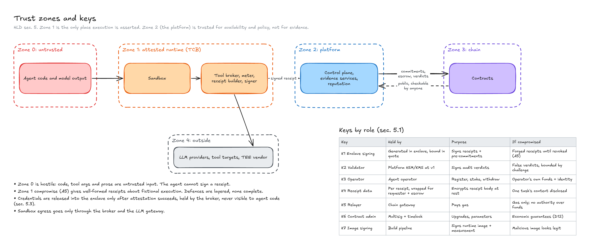

**Zone 0 is hostile.** The agent's code, its tool arguments and its prose are all untrusted input to
the runtime. The agent cannot sign a receipt (paper §5.1, A1), and a second isolation boundary
inside the enclave keeps it from reaching the broker's memory or keys (D6).

**Zone 1 is the only place execution is asserted.** It is trusted to the extent assumption 1 holds,
and no further. Its compromise (A5) produces well-formed receipts about fictional execution, and
nothing in this architecture detects that cryptographically (paper §12.5). The defences are layered
and none is complete: external state bindings, vendor diversity, stake and challenge, and `k`-of-`n`
redundant execution for high-value categories.

**Zone 2 is trusted for availability and for policy, not for evidence.** The platform is a party, not
a neutral oracle (paper §4.3). It operates validators at v1, which is why challenge must stay
permissionless and why the platform's own stake is slashable.

### 5.1 Keys, by role

Custody design is a P1 and P2 deliverable. This table fixes what each key is *for* and what its
compromise costs.

| Key | Held by | Purpose | If compromised |
| --- | --- | --- | --- |
| **K1** Enclave signing key | Generated inside the enclave; public key bound in the attestation quote | Signs receipts and signed pre-commitments | An attacker can forge receipts until the measurement or key is revoked. This is A5. |
| **K2** Validator key | Platform HSM or KMS at v1; outside validators at P5 | Signs audit verdicts | False verdicts; bounded by challenge and the platform's slashable stake |
| **K3** Operator key | The agent operator | Registers an identity, posts stake, withdraws | The operator's own funds and identity |
| **K4** Receipt data key | Per receipt, wrapped for the requester and for escrow | Encrypts the receipt body at rest | Disclosure of one task's content |
| **K5** Relayer key | Chain gateway | Pays gas for platform transactions | Gas loss only. It must hold no authority over escrow or stake. |
| **K6** Contract admin | Multisig with a timelock | Upgrades and parameter changes | Loss of the system's economic guarantees. Upgradeability itself is open (D12). |
| **K7** Image-signing key | Build pipeline | Signs the runtime image and its published measurement | A malicious image that appears legitimate. Mitigated by reproducible builds (C24). |

### 5.2 The attestation chain

1. The vendor's root of trust signs a **quote** over the enclave's measurement and public key (K1).
2. C15 checks the quote against the vendor root **and** against an **accepted-measurement list**.
3. The receipt's signature is checked against the key in the quote.
4. The quote's reference is committed on chain with the Merkle root.

Step 2 needs a place to record which measurements are accepted and who may change the list. **The PRD
lists no contract for it** (§14, item 6). It can live in ReceiptRegistry or in a small separate
registry (D8). Whoever controls that list controls which runtimes count, so its governance is part of
the trust model, not an operational detail.

### 5.3 Secrets and external credentials

Agents act on systems that need credentials: a Git host, a package registry, an API. This is where
the discarded prototype was weakest, and invariant 7 exists because of it.

- **Proposed:** credentials are released into the enclave **only after remote attestation succeeds**
  (attestation-gated release). They are short-lived and scoped, for example per-repository
  installation tokens, and they are held by the tool broker (C13), which attaches them to outbound
  calls. Agent code never sees a token and can never put one into a tool argument or a result.
- Receipts record **that** an authenticated call was made and its result, never the credential.
- Network egress from the sandbox goes through the broker and the LLM gateway only. This is also
  what lets a receipt claim anything about side effects: an unrecorded side effect outside the
  sandbox is constrained by egress control, not by the receipt (paper §6.4).

---

## 6. Data architecture

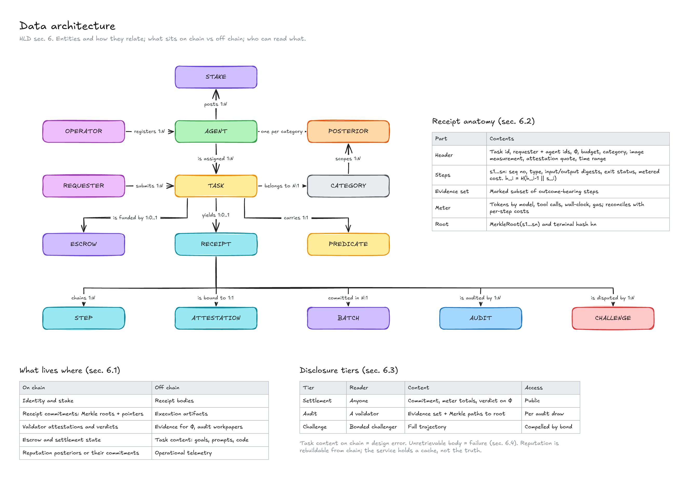

### 6.1 What lives where (paper §4.4)

| On chain | Off chain |
| --- | --- |
| Identity and stake | Receipt bodies |
| Receipt commitments: Merkle roots and pointers | Execution artifacts |
| Validator attestations and verdicts | Evidence for `Φ`, and audit workpapers |
| Escrow and settlement state | Task content: goals, prompts, code |
| Reputation posteriors, or their commitments | Operational telemetry |

**A write path that puts task content on chain is a design error** (PRD §8). Gas is part of metered
cost, not a separate budget.

### 6.2 Receipt anatomy

Owned by the **P0 receipt-format specification**, which also supplies test vectors. The parts, from
the paper (§6.2):

| Part | Contents |
| --- | --- |
| **Header** | Task id, requester and agent identities, `Φ` as submitted, budget, category, runtime image measurement, attestation quote, time range |
| **Step sequence** | Steps `s₁ … sₙ`, each with a monotonic sequence number, a type (model call, tool invocation, command, artifact write), digests of inputs and outputs, exit status where applicable, and metered cost. Hash-chained: `hᵢ = H(hᵢ₋₁ ‖ sᵢ)`. |
| **Evidence set** | The marked subset of steps that are outcome-bearing |
| **Meter** | Totals for tokens by model, tool calls, wall-clock time and gas, reconcilable against the per-step costs |
| **Root** | `MerkleRoot(s₁ … sₙ)` and the terminal hash `hₙ` |

Three properties are non-negotiable: the commitment covers the **complete** trajectory, steps are
**append-only**, and **metering happens inside the attested runtime**.

### 6.3 Disclosure tiers and who can read what

| Tier | Reader | Content | Access control |
| --- | --- | --- | --- |
| **Settlement** | Anyone | On-chain commitment, meter totals, verdict on `Φ` | Public |
| **Audit** | A validator | The evidence set with Merkle paths to the committed root | Granted per audit draw |
| **Challenge** | A bonded challenger | The full trajectory | Compelled by a posted bond |

### 6.4 Storage and availability

- **Proposed:** an S3-compatible object store addressed by content hash at first (D5), with the
  requester holding a copy, or the key to it, from settlement.
- **Data availability is a first-class requirement.** An operator can commit a root and withhold the
  body, which would make audit and challenge impossible while the commitment looks healthy. The
  rule (paper §12.7): **unavailability is failure.** A body that cannot be retrieved within a bounded
  period is treated as unsubstantiated, escrow returns, and repeated unavailability is slashable.
  The requester's own copy means the operator is not the sole custodian.
- **Batching** trades gas for a pre-commitment gap. Between completion and batch commitment, a
  receipt is not anchored, so the runtime issues a **signed pre-commitment** at completion and
  delivers it to the requester immediately (paper §11.4). Batch interval is a per-category parameter
  (D10).

### 6.5 Reputation state

Per agent and category: a Beta posterior `(α, β)` over validated success and a Gamma posterior
`(κ, τ)` over metered cost, both geometrically decayed, plus an agent-level posterior used as the
weak prior for thin categories. The state is a pure function of validated outcomes, so it must be
**reconstructible from chain data** by a third party (ReputationAnchor). The service holds a cache,
not the truth. The score is the ratio of expectations `D = E[θ]/E[c]`, not the expectation of a
ratio (paper §8.4).

---

## 7. Behaviour: flows and state

### 7.1 Staked-tier task, end to end

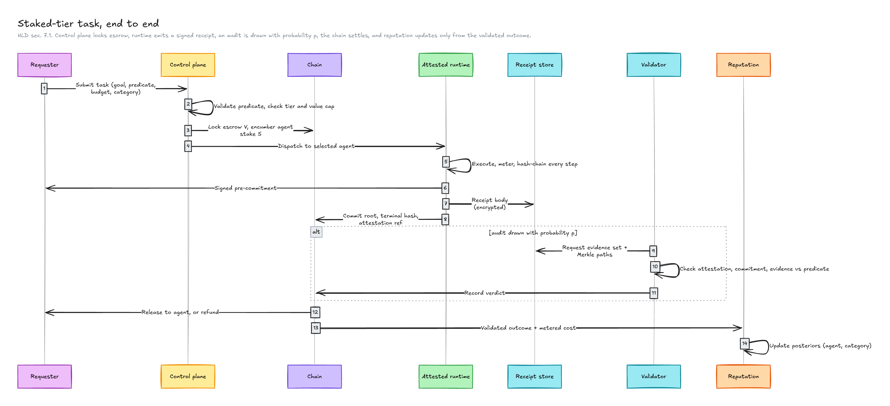

### 7.2 Task state machine

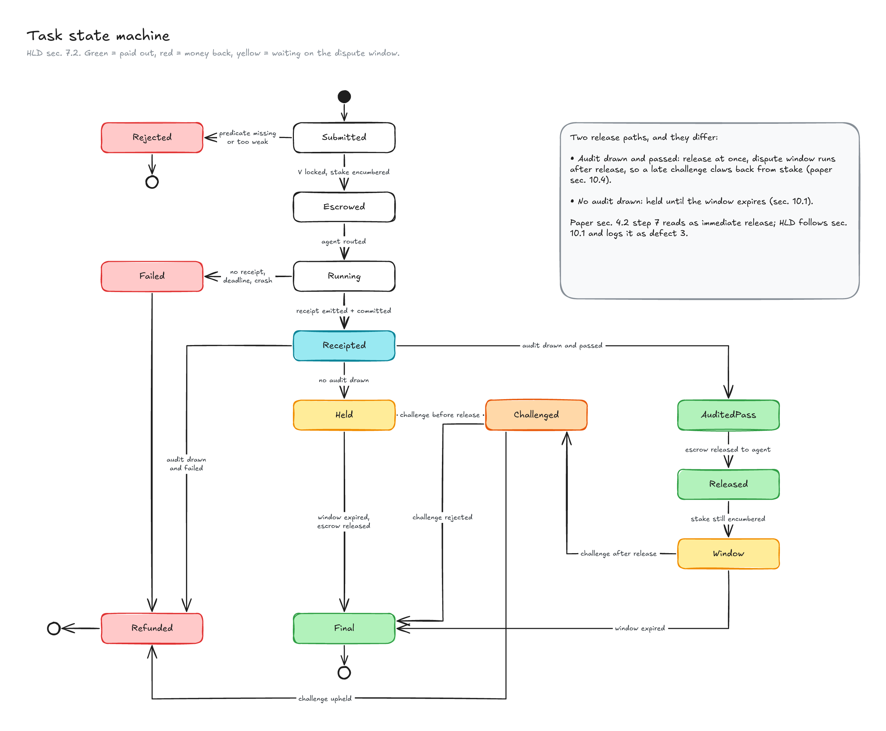

Two release paths exist and they differ. A receipt that **passes an audit** releases at once, and the
dispute window then runs *after* release, so a late challenge claws back from stake (paper §10.4). A
receipt that **no audit drew** is held until the window expires. The paper's §4.2 step 7 describes
the unaudited case as releasing immediately, while §10.1 holds it until expiry. This document
follows §10.1 and lists the wording difference as defect 3 in §14.

### 7.3 Challenge and clawback

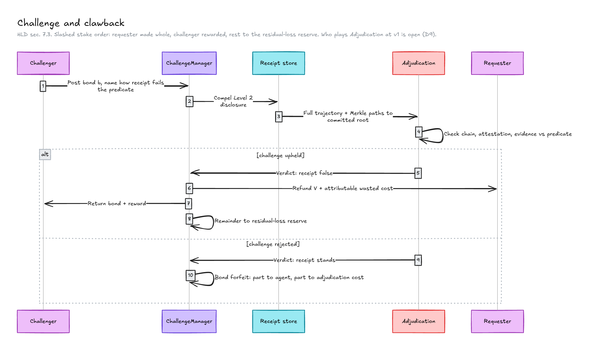

Slashed stake follows a fixed order: requester made whole, challenger rewarded, remainder to the
residual-loss reserve rather than burned (paper §10.3). **Who plays "Adjudication" at v1 is not
specified anywhere and is the largest open question in this document (D9).**

### 7.4 When a receipt never arrives, or its body cannot be fetched

Non-emission is treated as failure: escrow returns, the task records as a failure, and the agent's
cost posterior still updates, so suppressing a bad outcome is never better than reporting it (paper
§12.1, §12.2). A requester holding the signed pre-commitment can prove a receipt was suppressed.
Body unavailability is handled as in §6.4.

### 7.5 Onboarding-tier task

Differences from §7.1, and nothing else:

- Funded from the faucet ledger (C6), not from escrow on chain.
- **Audited at `p = 1`**, at platform expense, so the verification cost is a platform subsidy that
  must be rate-limited and value-capped.
- Excluded from autonomous routing.
- **Accrues no reputation that transfers to the staked tier** (invariant 6).

The onboarding tier buys onboarding, not trust. Any change that lets its history influence routing is
a Sybil hole.

### 7.6 Routing and the reputation loop

Routing is asynchronous to settlement. The router reads posteriors from C21 and the task's budget,
draws `θ̃ ~ Beta(α, β)` per candidate, and picks the maximum of `θ̃ / Ê[cost]` within budget. Retry
tolerance, budget tightness and exploration suppression modify the policy (paper §9.4).

The router **never** reads receipts or chain state directly, only posteriors. Posteriors move only on
validated outcomes. That composition is the structural defence: manipulating routing requires first
defeating verification (paper §9.7).

Exploratory draws go to under-evidenced agents. A validated failure on one is not billed to the
requester, and its cost is recorded in the subsidy ledger (C22), with exploratory allocation capped per
identity and per operator.

---

## 8. Interfaces

Names are illustrative. Each interface's definition is owned by the deliverable in the right column.

| ID | Interface | Between | Notes | Owner |
| --- | --- | --- | --- | --- |
| I1 | **Public API** | Clients and C2 | Task submission, receipt access by tier, challenge entry. Authenticated; tier checks live here. | P0 API spec |
| I2 | **Event stream** | C2 and clients, C4 and consumers | `task.submitted`, `receipt.committed`, `audit.completed`, `challenge.opened`, `settlement.final`, `posterior.updated` | P0 |
| I3 | **Runtime job protocol** | C10 and C11 | Dispatch a task, stream status, return the receipt. The platform cannot change a step through it. | P0 spec |
| I4 | **Attestation interface** | C11 and C15 | Produce and verify a quote; bind the key; release credentials after success | P1 |
| I5 | **Tool broker** | Agent code and C13 | The only way the sandbox acts on the world. Credentials never cross it. | P0 |
| I6 | **LLM gateway** | Agent code and C12 | Metered egress. Token counts are recorded as the provider reports them (§13, R7). | P0 |
| I7 | **Evidence API** | C14 and validators, challengers, requesters | Tiered. The same interface serves platform validators now and outside validators at P5. | P3 |
| I8 | **Verifier library** | Anyone | `verify(receipt, commitment, quote) → verdict, reasons`. No network access required. | P0 |
| I9 | **Chain gateway** | C4, C16, C21 and C19 | Submit, batch, confirm, reorg-safe reads | P2 |
| I10 | **Contract ABIs** | C19, C20, clients and C18 | Generated from the contracts repository, never copied by hand | P2–P4 |
| I11 | **Reputation read API** | C7, C1, public | Posteriors, value density, and the commitments that let a third party rebuild them | P4 |
| I12 | **Validator interface** | C16 and C14 | Request evidence, return a signed verdict. Identical for internal and external validators. | P3 |

---

## 9. Deployment and delivery by phase

Ordered, as in the PRD, by what de-risks the thesis fastest. Each phase says what exists afterwards
and what measurement starts.

| Phase | What exists | Where it runs | Deliberately absent | Measurement that starts |
| :---: | --- | --- | --- | --- |
| **P0** | Runtime, sandbox, metering, hash-chained steps, Merkle tree, signing; the receipt-format spec with test vectors; the verifier library and CLI; a minimal task service | Developer machines and a single host. **No TEE, so receipts are signed with a development key and carry an explicit "unattested" marker that the verifier refuses to treat as attested.** | Chain, money, attestation | Cost of producing a receipt; size of the evidence set against trajectory length; cost of an audit by the verifier (the real `c_audit`) |
| **P1** | TEE-backed sandbox, measured reproducible image, attestation verifier, accepted-measurement list | A host that supports the chosen TEE (D2); cloud confidential computing is the likely route | Chain | Enclave overhead on execution; attestation latency and failure rate |
| **P2** | Identity, ReceiptRegistry, chain gateway, indexer, L2 testnet; batched commitments with pre-commitments | Testnet | Money, challenge | Gas per task at various batch sizes; confirmation behaviour |
| **P3** | Escrow, StakeVault, ChallengeManager, dispute window, validator service, adjudication, tier service | Testnet, then a limited mainnet decision | Reputation, routing | Realized audit rate `p`; realized challenge rate `q`; adjudication time; faucet exposure |
| **P4** | Reputation engine, value-density routing, Thompson sampling, subsidy ledger | Same | Permissionless validation | Whether value-density ranking diverges from quality ranking on real traffic (S4) |
| **P5** | External validators on the same interface, with their own stake | Same | | A validator outside the platform earning from a correct audit |

**P0 can run on modest hardware, and P1 cannot.** A laptop or a small server is enough to build and
test the receipt format, the hash chain and the verifier. Anything involving attestation needs
hardware that supports it, so that cost starts at P1 and should be priced from a spike, not assumed.

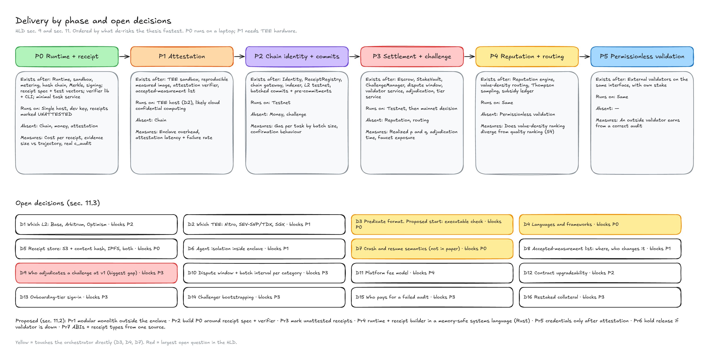

### 9.1 Environments

| Environment | Purpose | Notes |
| --- | --- | --- |
| Local | Development of the runtime and verifier | Unattested receipts only |
| CI | Build, test, reproducible image build | The measurement from CI must equal the published one |
| Staging | Full stack on a testnet | Faucet-funded |
| Production | Mainnet, if and when | Decided at P3, not before |

### 9.2 Build and supply chain

- **Reproducible runtime image** (C24). The published measurement is the hash of an image anyone can
  rebuild. A measurement nobody can reproduce proves nothing about what runs.
- Image and measurement signed with K7; the accepted-measurement list changes only through the
  governance in D8.
- Contract builds pinned and verified on the explorer; ABIs generated, never hand-copied.

---

## 10. Cross-cutting concerns

### 10.1 Security: threats to controls

| Adversary (paper §5.1) | Where it is stopped | Residual |
| --- | --- | --- |
| **A1** Dishonest agent | Cannot sign; shaping genuine execution is a predicate-quality problem (C5) | Weak predicates |
| **A2** Dishonest operator: forgery | TEE attestation (C11, C15) | A5 |
| **A2** Suppression | Signed pre-commitment, non-emission is failure, challenge of a missing receipt | Gap before the requester holds the pre-commitment |
| **A2** Identity churn | Stake at registration (StakeVault, Identity) | Cost of identity, not impossibility |
| **A3** Colluding requester | Value and difficulty weighting, concentration discounting, validation-gated updates (C21) | A patient adversary with diverse requesters |
| **A4** Lazy or hostile validator | Permissionless challenge, platform stake slashable; stake-weighted aggregation at P5 | v1 routine audit is centralized |
| **A5** Compromised TEE | External state bindings, vendor diversity, stake and challenge, `k`-of-`n` for high value | **Not closed.** Detected only by external contradiction. |

Plus the attack surfaces the paper treats separately: predicate quality (§12.6), data availability
(§12.7), and griefing of challenge and of the exploration subsidy (§12.8).

### 10.2 Failure behaviour

What each failure does, and what is meant to happen. These are design intentions, to be tested.

| Failure | Effect | Intended behaviour |
| --- | --- | --- |
| Runtime node dies mid-task | No receipt | Treated as `Failed`; escrow returns. **Resuming a partly executed task is open (D7)**, because side effects already happened. |
| TEE measurement revoked or key compromised | Receipts from that image become suspect | Stop accepting the measurement; receipts committed under it are flagged for audit at `p = 1` |
| Receipt store unavailable | Audit and challenge blocked | Unavailability is failure (§6.4); retention and replication are P0 requirements |
| Validator service down | **No audits are drawn** | Dangerous: unaudited receipts would release at window expiry. **Proposed:** hold release while validation is unavailable beyond a threshold, and alert. |
| Chain congestion or fee spike | Commitments delayed | Pre-commitments carry the gap; batch interval is adjustable per category |
| Chain reorg | A commitment or verdict disappears | Wait for finality before release; the indexer is reorg-safe |
| LLM provider outage | Tasks fail or stall | Fail the task cleanly; no partial-credit receipt |
| Indexer lag | Stale UI and routing inputs | UI shows staleness; settlement never reads the indexer |
| Control plane down | No new tasks | In-flight escrow and windows are enforced on chain, so money does not depend on its uptime |

**Time.** Dispute windows are measured in chain time, not in server clocks, so the control plane
cannot lengthen or shorten a window.

### 10.3 Observability and measurement

- **Operational telemetry is separate from receipts** and never influences settlement (C25).
- **Instrument for the claims from the first phase.** The success criteria are claims to be
  measured, so the system must emit the data: cost per receipt, cost per audit, realized `p` and
  `q`, evidence size against trajectory size, gas per task by batch size, faucet spend, and
  exploration-subsidy spend.
- A claim in any document about overhead stays labelled "model arithmetic" until one of these
  measurements replaces it.

### 10.4 Cost architecture (paper §11)

| Where cost arises | How the design contains it |
| --- | --- |
| LLM tokens | Routing by value density, caching and compression where they preserve evidence; measured, not assumed |
| Audit | Sampling at the agent's derived rate; evidence-subset reads; one verifier |
| Gas | Commit roots, not content; batch across tasks; settle in aggregate; operate on an L2 |
| Exploration | Proportional to posterior uncertainty; capped per identity and operator |
| Onboarding tier | Rate-limited and value-capped; a platform cost, not evidence the mechanism works |

### 10.5 Testing strategy

Following the repository's rule that a test asserting a guard fires is worth more than one asserting
the happy path:

- **Receipt properties:** omission and reordering of steps are detected; a post-hoc edit changes the
  root; an unattested receipt is refused as attested; a receipt with a missing step cannot verify.
- **Contract invariants:** stake cannot be withdrawn while encumbered; escrow cannot release before
  its conditions; a successful challenge distributes in the stated order; the concurrency cap holds.
- **Adversarial exercise (S3):** deliberate falsification by a staked agent is detected and slashed
  end to end.
- **Parity with the model:** the simulation in the research repository is the reference for the audit
  and slashing rules; the implementation is tested against it.
- **Failure injection** for each row of §10.2.

### 10.6 Privacy

Default non-disclosure is what makes the system usable on real code, and it also means routine
audits verify less than a full replay. The guarantee is "every task remains examinable," not "every
task was examined." Prompts, code and credentials are in Zone 1 and Zone 2 only, encrypted at rest
under K4, and reach a validator only as the evidence subset.

---

## 11. Decisions

### 11.1 Locked

From the paper's design decisions (the numbers are the decision numbers):

| # | Decision | Architectural effect |
| --- | --- | --- |
| 1 | Validator network, ERC-8004-aligned, refined to receipt audit with sampled re-execution | The validator interface (I12) |
| 2 | Hybrid payment: faucet credits for onboarding, connected wallet for production | Two tiers (C6, C8) |
| 3 | Ethereum L2, EVM-compatible | All of C18–C20; which L2 is open (D1) |
| 4 | LLM tokens and gas treated as one combined cost problem | Single meter in the receipt |
| 6 | Bayesian, decay-weighted reputation per task category | C21 |
| 7 | Staking as the Sybil baseline, with credentials reducing required stake | Identity and StakeVault |
| 11 | General-purpose protocol, with software-engineering agents as the flagship | Executable predicates first (D3) |
| 13 | Cost-adjusted reputation is the headline contribution | Metering inside the enclave |
| 15 | Runtime trust anchor is TEE attestation | C11, C15 |
| 16 | Receipts commit to the complete trajectory and disclose selectively | §6.2, §6.3 |
| 17 | Permissioned audit, permissionless challenge, at v1 | C16 at v1; I12 stable for P5 |

### 11.2 Proposed

| ID | Proposal | Reasoning |
| --- | --- | --- |
| **Pr1** | Start as a **modular monolith** for everything outside the enclave, and split on trust or fault boundaries | v0.2's service mesh was premature; the only boundary that must exist on day one is runtime versus the rest |
| **Pr2** | Build **P0 around the receipt-format specification and the verifier**, before the full runtime | The verifier and test vectors are what make S2 achievable and keep the format honest |
| **Pr3** | Mark unattested receipts explicitly, and make the verifier refuse to call them attested | A development key must never be mistakable for evidence |
| **Pr4** | Write the **runtime and receipt builder in a memory-safe systems language** (Rust is the obvious candidate), and keep it small; use whatever is fastest for the control plane | The enclave is the TCB, so its size and memory safety matter more than development speed there |
| **Pr5** | Release credentials into the enclave only after attestation succeeds | §5.3 |
| **Pr6** | Hold release if the validator service is down beyond a threshold | §10.2 |
| **Pr7** | Generate ABIs and receipt types from one source of truth | Two copies diverge |

### 11.3 Open

| ID | Decision | Options | What decides it | Blocks |
| --- | --- | --- | --- | --- |
| **D1** | Which L2 (PRD Q1) | Base, Arbitrum, Optimism | Fee predictability at per-task volume; ERC-8004 ecosystem presence; precedent for attested commitments. Measure on testnets. | P2 |
| **D2** | Which TEE (PRD Q2) | Nitro Enclaves; AMD SEV-SNP or Intel TDX confidential VMs; SGX | A spike per candidate. Known constraints to verify, not assume: Nitro enclaves have no direct network or persistent storage, so tool access goes through a proxy on the parent instance; confidential VMs suit a general sandbox better but the SEV-SNP attestation attacks the paper cites matter. A single-vendor v1 needs a documented path to a second (paper §12.5). | P1 |
| **D3** | How an outcome predicate is expressed (PRD Q3) | A DSL; an executable check; a signed assertion set | **Proposed start:** an executable check (command, expected exit, path constraints, artifact hashes), which covers the running example | P0 |
| **D4** | Languages and frameworks | See Pr4 | A first implementation spec | P0 |
| **D5** | Receipt store | S3-compatible with content hashing; IPFS; both | Retrieval guarantees, cost, key management | P0 |
| **D6** | Isolation of agent code *inside* the enclave | Container with a hardened profile; a user-space kernel; a microVM | The agent is untrusted, and the enclave must protect its signing key from it | P1 |
| **D7** | Crash and resume semantics | Treat as failed; resume from a checkpoint with a continued hash chain; compensating actions | Side effects already landed, so a naive resume risks repeating them. **Not covered by the paper.** | P0 |
| **D8** | Where accepted runtime measurements are recorded, and who changes the list | In ReceiptRegistry; a separate registry; off chain with a published log | It controls which runtimes count, so it is a governance decision | P1 |
| **D9** | **Who adjudicates a challenge at v1** | The platform; a panel; an external arbiter; an on-chain game where re-execution is possible | The paper requires adjudication "against evidence" but names no adjudicator. If the platform adjudicates, then permissionless challenge protects less than it appears to. **Not covered by the paper or the PRD.** | P3 |
| **D10** | Dispute window `W` and batch interval, per category | Per category | Failure latency per category (paper §10.2) | P3 |
| **D11** | Platform fee model (PRD Q7) | | Must not bring back an incentive to prefer expensive agents | P4 |
| **D12** | Contract upgradeability | Immutable; proxy with timelock and multisig; migration by redeploy | Trade-off between fixing a bug and trusting an admin key | P2 |
| **D13** | Requester sign-in for the onboarding tier | Email, OAuth, passkey, wallet | Abuse resistance against faucet farming (PRD Q6) | P3 |
| **D14** | Challenger bootstrapping (PRD Q5) | Seeded challenger set, bounties, automated challenge bots | The mechanism cannot enforce `q > 0` | P3 |
| **D15** | Who pays for a failed audit (PRD Q4) | | Validator economics and the realized audit rate | P3 |
| **D16** | Restaked collateral (PRD Q8) | Dedicated collateral only; accept restaked with a lower recoverable value | Recoverable value is below `λS` if `S` secures obligations elsewhere. Unquantified. | P3 |

---

## 12. Repositories and module layout

| Repository | Holds | Licence | State |
| --- | --- | --- | --- |
| [`mergit-research`](https://github.com/mergit-io/mergit-research) | The paper, whitepaper, simulation, the research site | CC BY 4.0 for text | Source of truth for the design |
| [`mergit`](https://github.com/mergit-io/mergit) | Runtime, control plane, verifier, web app, docs, brand | GPL-3.0 code; `docs/` CC BY 4.0 | Front end over mock data, brand kit and documents only |
| [`mergit-contracts`](https://github.com/mergit-io/mergit-contracts) | Solidity | MIT | **README still describes the superseded Monad design** (§14, item 2) |
| `Mergit-proto` | The discarded v0 prototype | | Archived; read for lessons, never for code |

### 12.1 Proposed layout of `mergit`

```text
mergit/
  spec/             receipt format, wire protocols, test vectors (versioned)
  runtime/          harness, sandbox, tool broker, meter, receipt builder and signer
  verifier/         verification library and CLI, no dependency on runtime internals
  control-plane/    task service, predicate, router, tiers, accounts, reputation, subsidy ledger
  evidence/         receipt store, disclosure, validator worker, attestation verifier
  chain/            gateway and indexer; ABIs generated from mergit-contracts
  frontend/         exists today
  deploy/           infrastructure as code, image build and measurement
  docs/             PRD.md, HLD.md
  brand/            exists today
```

The one rule that matters: **`verifier/` must not import from `runtime/`.** It reads the format
in `spec/`. If the verifier needs the runtime to verify, S2 is not met.

---

## 13. Architecture-level risks

Restated from the paper's limitations (§13) at the level where architecture can help or hurt.

| # | Risk | Effect | Architectural response | Closed? |
| --- | --- | --- | --- | --- |
| R1 | **A compromised TEE** | Well-formed receipts about fictional execution | State bindings, vendor diversity, stake and challenge, `k`-of-`n` | **No** |
| R2 | **v1 verification is centralized** | The platform sits on the routine audit path | Permissionless challenge, platform stake slashable, stable validator interface | Partly, by design |
| R3 | **Challenger liveness** | `q = 0` collapses the economics | Make challenge cheap and rewarding; do not rely on it alone | No (an assumption) |
| R4 | **Adjudication is undefined (D9)** | Challenge may not protect what it claims to | Decide before P3 | **No** |
| R5 | **Weak predicates** | Faithful verification of the wrong thing | C5 templates and warnings; surface assurance to the requester | No |
| R6 | **Data availability** | Healthy-looking commitments with withheld bodies | Unavailability is failure; requester copy | Largely |
| R7 | **Metering depends on provider-reported usage** | Cost-adjusted reputation is only as sound as the token counts, and a provider's usage report is outside the enclave | Treat it as an explicit assumption; self-hosted models inside the enclave would remove it | **No** |
| R8 | **Crash and resume with side effects (D7)** | Duplicate or half-done actions | Decide the semantics early | No |
| R9 | **Batch window** | A receipt is unanchored until commitment | Signed pre-commitment, shorter batches for high-value categories | Partly |
| R10 | **Thin collateral** | At low stake the model audits a large share of tasks | Value caps by stake; concurrency cap | A model result, not a measurement |
| R11 | **Key management** | K1 and K6 are single points of loss | Custody design in P1 and P2; timelock and multisig | Open |
| R12 | **Onboarding-tier cost** | Free audited tasks scale with growth | Rate limits, value caps, treat as a cost centre | No |
| R13 | **Scope creep before the thesis is tested** | Repeats v0.2 | Phase order by risk; P0 first | By discipline |

---

## 14. Known inconsistencies in the current documents

Found while preparing this document. Each is a defect in the document named, not a decision.

| # | Where | Defect |
| --- | --- | --- |
| 1 | **PRD §9**, E3 and E4, and its worked reference point | Uses the superseded one-shot rule (`q ≈ 0.034`, "one in thirty", `n_max ≈ 30`). The paper's corrected rule is `P_d·(V + λS) ≥ max(c_exec + (1 − θ)V, V)`, which gives a challenge threshold of about 0.0625 at the same parameters, an exact concurrency bound of 18 in the paper's example, and an audit rate sized for the concurrency allowance (paper §7.2, §7.5, §7.7). This HLD follows the paper. |
| 2 | **`mergit-contracts` README** | Describes AgentPassport, ProofOfWork, ReputationRegistry and AuditTrail on Monad, which the repository's own guidance lists as superseded. The current set is Identity, ReceiptRegistry, StakeVault, Escrow, ChallengeManager, ReputationAnchor on an L2. |
| 3 | **Paper §4.2 step 7 versus §10.1** | Step 7 says escrow releases "on no audit being drawn"; §10.1 says release needs no audit draw **and** window expiry. To be raised on `mergit-research`, not fixed here. |
| 4 | **Front end sign-in and landing page** | Shows invented figures ("0% silent failures", "42 tools, 4 apps", "859 tests"), which breaks the rule that no number is presented as measured. |
| 5 | **Whitepaper header** | Dated 2026-10-09 and "draft 1" although it carries revision-5 content. |
| 6 | **PRD §8 and paper §6** | No place is named for the list of accepted runtime-image measurements (D8). |
| 7 | **Paper and PRD** | Neither names who adjudicates a challenge at v1 (D9), or the semantics of a crashed task (D7). |

---

## 15. Glossary

| Term | Meaning |
| --- | --- |
| **Receipt** (Verifiable Execution Receipt) | A signed, hash-chained, hardware-attested record of what a task executed and what it cost |
| **Predicate `Φ`** | The checkable statement of what "done" means for a task |
| **Evidence set** | The outcome-bearing subset of a receipt's steps, read at routine audit |
| **Value density `D`** | `E[verified success] / E[metered cost]` for an agent in a category |
| **`p`, `q`, `P_d`** | Audit probability; probability an unaudited false receipt is challenged; detection probability `p + (1 − p)q` |
| **`V`, `S`, `λ`** | Task payment; agent stake; slashing fraction |
| **TCB** | Trusted computing base: what must be trusted for the evidence to mean anything |
| **Measurement** | The hash identifying exactly which runtime image an enclave is running |
| **Quote** | The vendor-signed attestation binding a measurement to an enclave key |
| **Window `W`** | The period during which a receipt can be challenged |
| **Onboarding tier / staked tier** | Faucet-funded, fully audited, no transferable reputation / stake-backed, sampled audit, reputation accrues |

## 16. Orchestrator implementation track

**Status:** Proposed. This section is the implementation plan for C4 (task service), C5 (predicate
service), C7 (router) and the C10–C13 runtime, written by the engineer building that track. It is
downstream of §4 and §9 above: where it repeats a decision already locked there, that decision
wins. New text here is **Proposed**, in the sense §1 defines, until it lands in §11.

### 16.1 Architecture

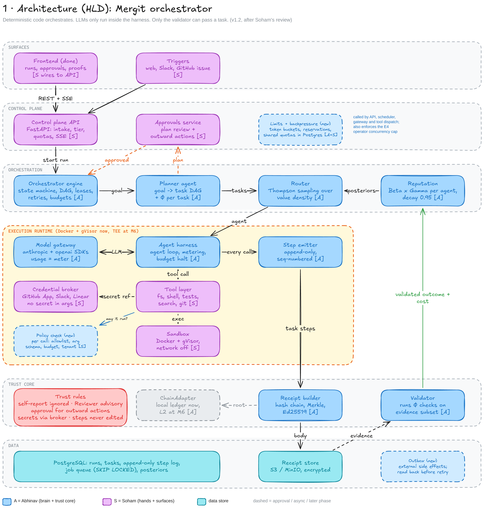

Maps onto the layers of §4: Surfaces = C1–C2, Orchestration = C4 (task service) and C7 (router),
Execution runtime = C10–C13, Trust core = the receipt builder inside C11 plus C16's predicate
checks. `Limits + backpressure`, `Policy check` and `Outbox` are additions this track needs that
are not yet components in §4 — they belong inside C6, C13 and C10 respectively.

### 16.2 Run workflow

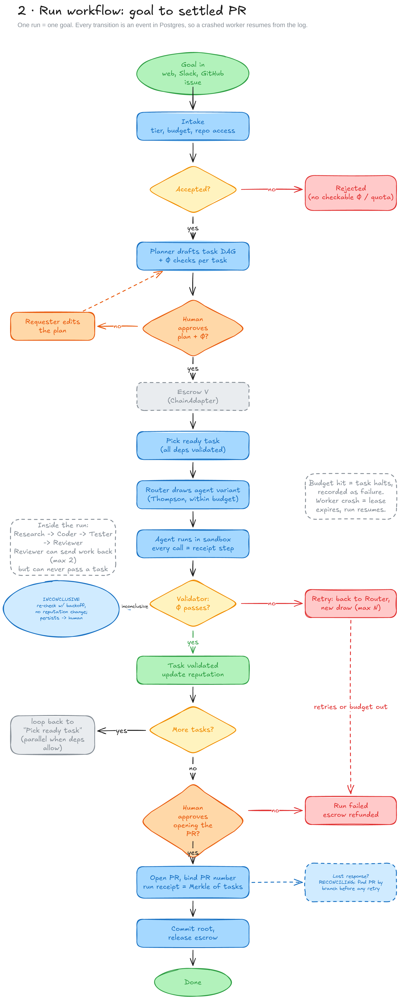

One run is a DAG of tasks (§16 extends the data model of §6: `RUN 1:N TASK`, each task still
carries one `Φ` as in §6's `TASK ||--|| PREDICATE`). Every transition is an event in Postgres, so a
crashed worker resumes from the log rather than from in-memory state — this is the proposed answer
to **D7** (§11.3), open in the paper. `INCONCLUSIVE` is a third predicate outcome, alongside pass
and fail, that never updates reputation (extends invariant 4, Appendix B).

### 16.3 Decisions and build order

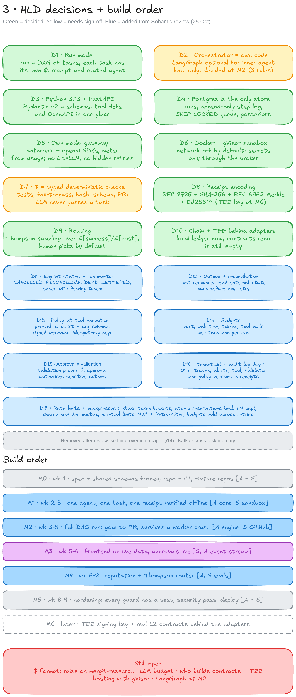

These are implementation-level decisions underneath the ones in §11 — D1–D17 here are a separate,
lower-level list from the D1–D16 in §11.3 and should not be confused with them. Where the two
overlap (D2 here vs. D4 in §11.3 on language; D10 here vs. D2 in §11.3 on TEE/chain), §11.3 governs.

### 16.4 Request flow

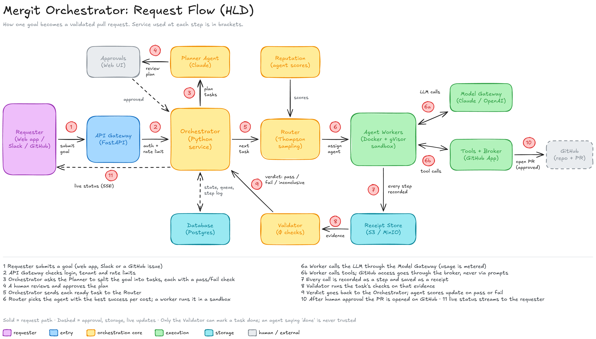

The orchestrator-only walkthrough of the sequence in §7.1, with the service names this track plans
to build rather than the component ids of §4.

### 16.5 Where this plugs into the rest of the system

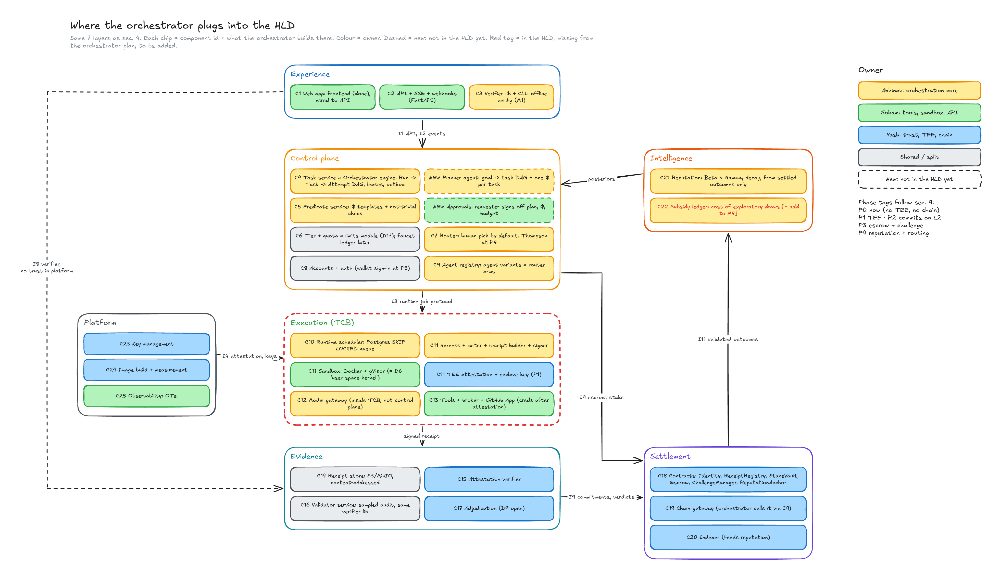

Colour is ownership, not trust. The execution layer (C10–C13) stays the trusted computing base of
§5 regardless of who writes the code in it — the dashed boxes (Planner agent, Approvals) are new
components this track adds inside C4/C5 that §4 does not yet name.

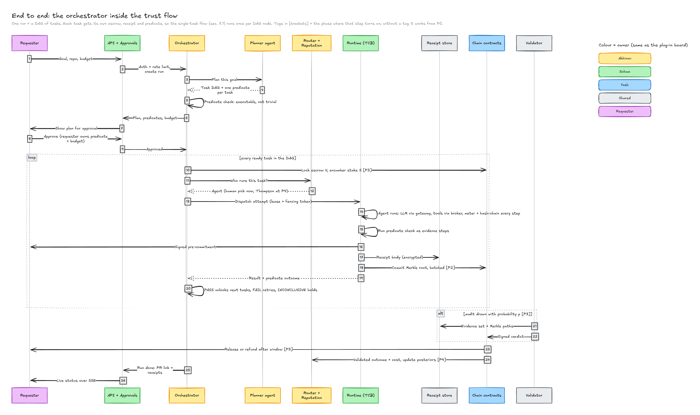

This is §7.1's sequence run once per DAG node instead of once per task, with the phase tag from §9
marking where each step turns on.

### 16.6 Changes and open questions against this HLD

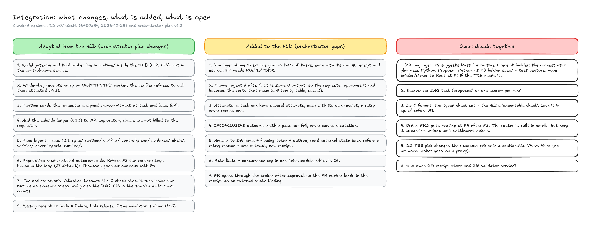

The left column is this track's plan changing to match §4–§7. The middle column is a gap in this
HLD that the orchestrator needs filled (run-level DAG, attempts, `INCONCLUSIVE`, D7). The right
column needs a decision before P0 can lock: D4 (language — §11.2 Pr4 proposes Rust for the runtime
and receipt builder; this track's current plan is Python behind `spec/` and its test vectors, with
the receipt builder and signer moving to Rust at P1 if the TCB needs it), escrow granularity per
task vs. per run, and ownership of C14 and C16.

---

## Appendix A — Traceability

| Item | Satisfied by | Phase |
| --- | --- | --- |
| **R1** Verification without re-execution | C11, C3, receipt format | P0 |
| **R2** Evidence integrity | C11, C15, C3, K1, accepted-measurement list | P0–P1 |
| **R3** Bounded verification cost | Tiered disclosure (C14), C16, batching (C19) | P0–P3 |
| **R4** Priced identity | Identity, StakeVault (C18) | P2–P3 |
| **R5** Cost as a signal | Meter in C11, C21 | P0, P4 |
| **R6** Exploration | C7, C22 | P4 |
| **F1** Task submission with a predicate | C2, C4, C5 | P0 |
| **F2** Attested execution | C10, C11, C15 | P1 |
| **F3** Receipt generation, non-optional | C11 | P0 |
| **F4** On-chain commitment | C19, ReceiptRegistry | P2 |
| **F5** Sampled audit | C16, derived rate from C21 | P3 |
| **F6** Permissionless challenge | ChallengeManager, I7 | P3 |
| **F7** Stake and slashing | StakeVault | P3 |
| **F8** Cost-adjusted reputation | C21, ReputationAnchor | P4 |
| **F9** Autonomous routing | C7 | P4 |
| **F10** Revocable settlement | Escrow, ChallengeManager | P3 |
| **F11** Access tiers | C6, C8 | P3 |
| **F12** Receipt inspection UI | C1 over C3 | P0 |
| **S1–S5** Success criteria | Instrumentation in §10.3 | From P0 |

## Appendix B — Invariants and where they are enforced

From the repository's `CLAUDE.md`. Each is load-bearing for a claim in the paper.

| # | Invariant | Enforced by |
| --- | --- | --- |
| 1 | A receipt commits to the complete trajectory | Receipt builder (C11); the verifier rejects a receipt whose root does not cover all numbered steps |
| 2 | Steps are append-only | Enclave memory model and hash chain; tested by the omission and reordering tests |
| 3 | Metering happens inside the attested runtime | Meter in C11; the LLM gateway (C12) and broker (C13) are inside the TCB |
| 4 | Only validated outcomes update reputation | C21 input contract; reconstructible from chain by a third party |
| 5 | Audit cost scales with evidence volume, not trajectory length | Disclosure tiers (C14); the verifier's cost is measured against both |
| 6 | Faucet-tier work accrues no transferable reputation | C6 and C21 input filter; tested |
| 7 | No credential is reachable from a model-populated tool argument | Tool broker (C13) and attestation-gated release (§5.3) |

---

<sub>Source of truth: <a href="https://github.com/mergit-io/mergit-research">mergit-research</a>. This document is downstream of it.</sub>
